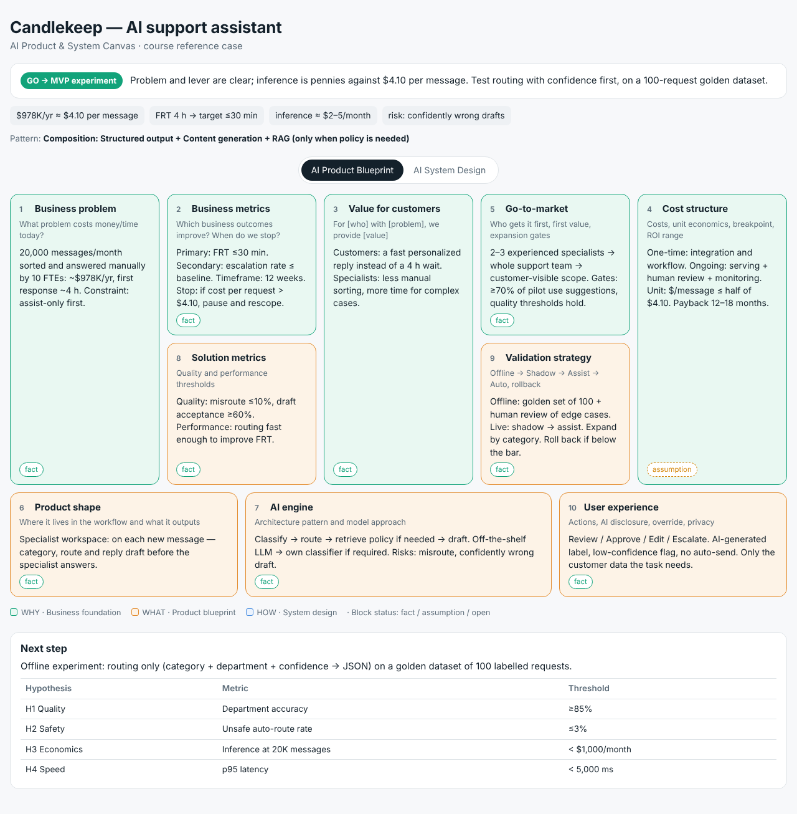

# AI Initiative Canvas — a Claude skill

A Claude skill that turns an AI idea into a decision-ready **AI Product & System Canvas**, following the method taught in the Nebius Academy *AI Leader* course.

Give it an idea ("our CTO wants an AI agent for the IT helpdesk"), a migration question ("should we move from GPT-4o to Nebius Token Factory?") or someone else's pitch, and it produces:

- a **document**: verdict (GO → MVP experiment / REFRAME / NO-GO), Canvas components 1–10, architecture pattern, inference economics, model and deployment choice, MVP hypotheses H1–H4, risks and compliance, gate review, and questions for engineers;
- a **visual Canvas board** (HTML) in the course layout — WHY / WHAT / HOW blocks with a *fact / assumption / open* status on each.



## How it works

| Mode | When | What happens |
|---|---|---|
| **Wizard** | The request is vague or solution-first ("an agent that handles everything"), or key facts are missing | Step-by-step questions per Canvas block: "Step 3 of 10 · Value for customers", progress bar, 1–4 questions with defaults, "Next step: …" |
| **Full** | Most facts are given | Full Canvas + economics + MVP plan + both deliverables |
| **Quick** | "Ballpark it" | Problem, metrics, cost, pattern, inference estimate, H1–H4, verdict |
| **Review** | You bring a proposal or pitch | Quote → why it's a problem → corrected wording, then a verdict |

Built-in rules from the course: decision cascade (problem before model), one primary financial lever, a mandatory stop condition, business metrics kept apart from AI metrics, simplest-pattern-that-fits, smallest model that reliably solves the task, Shadow → Assist → Auto, thresholds set before results, no false precision.

**Language:** English by default for everything it produces; it switches to another language only when asked explicitly.

## Repository layout

```
skills/ai-initiative-canvas/
├── SKILL.md                         # workflow, modes, language and style rules
├── references/
│   ├── wizard.md                    # step-by-step questioning protocol + question bank
│   ├── canvas_components.md         # components 1–10: formats, boundaries, common mistakes
│   ├── architecture_patterns.md     # 5 patterns, selection algorithm, case studies
│   ├── economics_and_models.md      # cost structure, token economics, model choice, deployment
│   ├── validation_and_experiments.md# validation phases, MVP H1–H4, metrics, decisions
│   ├── risk_compliance.md           # safety / security / GDPR / EU AI Act
│   ├── nebius_stack.md              # Token Factory, Serverless, AI Cloud, Tavily (prices as of Oct 2026)
│   ├── gate_review.md               # pre-delivery checklist and verdict rules
│   └── example_candlekeep.md        # the course's reference case
├── scripts/
│   ├── token_cost.py                # inference cost per unit / month / year / peak, multi-model
│   └── render_canvas.py             # canvas.json → self-contained canvas.html
└── assets/
    ├── canvas_template.md           # document structure
    └── example_canvas.json          # board JSON schema + example
examples/                            # rendered boards and a sample output document
```

## Install

- **Claude Code:** copy `skills/ai-initiative-canvas` into `~/.claude/skills/` (personal) or `.claude/skills/` in a project.
- **Claude apps:** zip the `skills/ai-initiative-canvas` folder and add it as a custom skill.

The scripts need only Python 3 (standard library).

```bash
python skills/ai-initiative-canvas/scripts/token_cost.py --requests 20000 --in-tokens 174 --out-tokens 155 \
  --preset gpt-oss-120b --preset frontier --baseline-unit-cost 4.10
python skills/ai-initiative-canvas/scripts/render_canvas.py skills/ai-initiative-canvas/assets/example_canvas.json -o canvas.html
```

## Notes

- Model prices in `nebius_stack.md` and the script presets are list prices as of October 2026 — verify them before relying on a calculation.
- The method and the Candlekeep case come from the Nebius Academy *AI Leader* course (Canvas by Mikhail Rozhkov); this repository is an independent study project and is not affiliated with or endorsed by Nebius.
